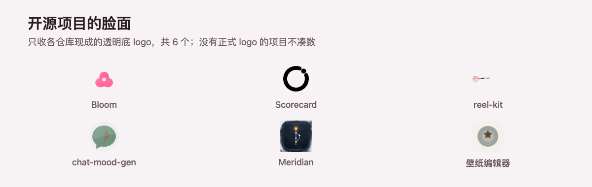

<!-- 本文件由 scripts/build-readme.mjs 生成，请勿手改。
     改内容请改 data/projects.json，然后跑 node scripts/build-readme.mjs。
     语言：en -->

  <picture>
    <source media="(prefers-color-scheme: dark)" srcset="./assets/hero-dark.svg" />
    
  </picture>

  I build two kinds of things: tools that make AI-assisted coding safer and observable, and design systems whose standards can be checked by code. 
  Design-minded engineer · Agent infrastructure · Testable design systems

  <a href="https://webkubor.online">Website</a> ·
  <a href="https://github.com/webkubor?tab=repositories">All repos</a> ·
  <a href="https://x.com/webkuborDev">X</a> ·
  <a href="./README.md">中文</a>

  
  
  
  

  Recently updated：[🛡️ frontend-contrast-guard](https://github.com/webkubor/frontend-contrast-guard) 10-26 · [📋 Scorecard](https://github.com/webkubor/scorecard) 10-26

  <picture>
    <source media="(prefers-color-scheme: dark)" srcset="./assets/logowall-dark.png" />
    
  </picture>

[Bloom for Typora](https://github.com/webkubor/typora-Bloom-theme) · [Scorecard](https://github.com/webkubor/scorecard) · [reel-kit](https://github.com/webkubor/reel-kit) · [chat-mood-gen](https://github.com/webkubor/chat-mood-gen) · [meridian](https://github.com/webkubor/meridian) · [wallpaper-generator](https://github.com/webkubor/wallpaper-generator)

### Agent tools

  <picture>
    <source media="(prefers-color-scheme: dark)" srcset="./assets/agent-dark.svg" />
    
  </picture>

From "let AI write code" to "let it see and stay safe".

- **[👀 Agent Eyes](https://github.com/webkubor/vite-plugin-agent-eyes)** — A Vite runtime telemetry layer for coding agents. It turns API errors, browser state and proxy details into evidence an agent can read, so it can locate and verify a fix on its own.  · MIT · [npm](https://www.npmjs.com/package/vite-plugin-agent-eyes)
- **[🔐 Kyvault](https://github.com/webkubor/kyvault)** — A local secret vault built for AI workflows: encrypted on your machine, tools fetch secrets by alias, and the agent never handles the plaintext.  · Rust · MIT · [crates.io](https://crates.io/crates/kyvault)
- **[🖥️ DSH Env Inspector](https://github.com/webkubor/dsh-env-inspector)** — Checks your dev environment, CLIs, plugins and ports, making environment problems visible and fixable without exposing secret values.  · [npm](https://www.npmjs.com/package/@dsh-plugins/dsh-env-inspector)
- **[🔄 Vite Refresh Guard](https://github.com/webkubor/vite-plugin-refresh-guard)** — Stops users from staying on a stale build after you deploy. Pick silent reload, prompted reload or a blocking wait in one line of config; the core works with Vue and React.  · MIT · [npm](https://www.npmjs.com/package/vite-plugin-refresh-guard)

### Bloom: a design system where visual judgment can be tested

  <picture>
    <source media="(prefers-color-scheme: dark)" srcset="./assets/bloom-dark.svg" />
    
  </picture>

Not just pretty colors: every palette runs on two rails, so design choices can be checked automatically.

- **[🌸 Bloom for Typora](https://github.com/webkubor/typora-Bloom-theme)** — 24 themes for long-form writing and immersive reading; included in the official Typora theme gallery.  · [Typora 官方收录](https://theme.typora.io/theme/Bloom/)
- **[🎛️ Bloom for DSH](https://github.com/webkubor/dsh-bloom-theme)** — The same Morandi visual language brought to DeepSeek Harness, with light and dark themes and OKLCH palettes. 
- **[🛡️ frontend-contrast-guard](https://github.com/webkubor/frontend-contrast-guard)** — Checks color contrast in CI with OKLCH support; when a pair fails, it tells you which way to adjust. 

### Skills: writing standards for agents

Standards for thinking "how should this be said" before writing docs, tickets or posts. One command to install into Claude Code / Codex / DSH / Antigravity.

- **[✍️ writing-standard-skills](https://github.com/webkubor/writing-standard-skills)** — 6 writing skills plus a 5D atomic matrix: build the skeleton, pick the reader, tune the tone, then reread as the reader. 
- **[🪦 deadcode-reaper-skill](https://github.com/webkubor/deadcode-reaper-skill)** — Retires dead code and stale skills for good, and shows off the subtraction. 
- **[🩹 charmoji-sticker-skill](https://github.com/webkubor/charmoji-sticker-skill)** — One front-facing character portrait becomes a complete, submittable WeChat sticker set, fully scripted. 

Also in progress

- **[📋 Scorecard](https://github.com/webkubor/scorecard)** — Public quality checks for GitHub repos, npm packages and websites, with evidence, a radar chart and a fix list.  · [在线体验](https://scorecard.webkubor.online) · [源码](https://github.com/webkubor/scorecard)
- **[🎙️ VoxFlow](https://github.com/webkubor/voxflow)** — A local AI audio workbench for Apple Silicon covering Chinese speech, voice design, podcasts and BGM; private audio stays on your machine. 
- **[🧭 dsh-llm-hub](https://github.com/webkubor/dsh-llm-hub)** — Adds model gateway probing, catalog discovery and balance info to DSH.  · [npm](https://www.npmjs.com/package/@dsh-plugins/dsh-llm-hub)
- **[🎞️ reel-kit](https://github.com/webkubor/reel-kit)** — Composes vertical short videos locally from footage, line-by-line scripts, voiceover and templates. 
- **[💬 chat-mood-gen](https://github.com/webkubor/chat-mood-gen)** — A generator for WeChat- and Xiaohongshu-style chat mood screenshots: chat, group, feed, moments and post modes. 
- **[🎨 museav-cli](https://github.com/webkubor/museav-cli)** — MUSE AV CLI for image and video generation, reusable templates, asset uploads and local image tools. 

Recently shipped (by push time)

- **[🛡️ frontend-contrast-guard](https://github.com/webkubor/frontend-contrast-guard)** 2026-10-26 · 0 ★ Checks color contrast in CI with OKLCH support; when a pair fails, it tells you which way to adjust.
- **[📋 Scorecard](https://github.com/webkubor/scorecard)** 2026-10-26 · 1 ★ Public quality checks for GitHub repos, npm packages and websites, with evidence, a radar chart and a fix list.

More tools

- **[ai-sse-kit](https://github.com/webkubor/ai-sse-kit)** — A framework-agnostic toolkit for streaming AI chat, with React / Vue bindings.
- **[facet](https://github.com/webkubor/facet)** — One Markdown file becomes slides, a PDF and a long image.
- **[ai-orb](https://github.com/webkubor/ai-orb)** — A 4KB zero-dependency SVG that shows what an AI assistant is doing.
- **[mlx-vlm-kit](https://github.com/webkubor/mlx-vlm-kit)** — Local, offline image understanding on Apple Silicon.
- **[im-notify-kit](https://github.com/webkubor/im-notify-kit)** — A Lark / WeCom notification library with retries and deduplication.
- **[path-guard](https://github.com/webkubor/path-guard)** — PATH diagnostics CLI: find the copy that actually runs and detect version drift.
- **[supercli](https://github.com/webkubor/supercli)** — A CLI directory and discovery site ranked by purpose and a Stars snapshot.
- **[meridian](https://github.com/webkubor/meridian)** — A calm macOS Git client. Tauri 2 + Vue 3 + git2.
- **[wallpaper-generator](https://github.com/webkubor/wallpaper-generator)** — A browser wallpaper editor: device presets, watermarks and PNG export.
- **[xiaobai-kanban](https://github.com/webkubor/xiaobai-kanban)** — A Chinese beginner guide to coding agents, requirements and Git workflows.
- **[cs-mcp](https://github.com/webkubor/cs-mcp)** — An MCP server that strings a personal open-source toolchain into AI agents, per capability group.
- **[lite-browser](https://github.com/webkubor/lite-browser)** — Browser automation CLI for AI agents with CDP, reusable sessions and human handoffs.
- **[device-passport](https://github.com/webkubor/device-passport)** — Deterministic, self-consistent browser/device personas for automation and testing.
- **[free-imgbed](https://github.com/webkubor/free-imgbed)** — Image assets for personal projects, served over GitHub raw and jsDelivr.
- **[dsh-museav-assets](https://github.com/webkubor/dsh-museav-assets)** — A DSH plugin that browses generated assets and image libraries by workspace.
- **[release-sync-skill](https://github.com/webkubor/release-sync-skill)** — Syncs release versions into the ledger and SKILL.md at publish time.
- **[suno-publisher](https://github.com/webkubor/suno-publisher)** — A music release management dashboard: release ledger and form-filling help.
- **[claude-usage-statusline](https://github.com/webkubor/claude-usage-statusline)** — A Claude Code status line: session cost and quota warnings.

  Every project starts from a real problem in a real workflow: it works, it can be verified, and others can pick it up. Built in public · Open source · Practical tools for people and agents

