<!-- 本文件由 scripts/build-readme.mjs 生成，请勿手改。
     改内容请改 data/projects.json，然后跑 node scripts/build-readme.mjs。
     语言：en -->

  <picture>
    <source media="(prefers-color-scheme: dark)" srcset="./assets/hero-dark.svg" />
    
  </picture>

  I build two kinds of things: tools that make AI-assisted coding safer and observable, and design systems whose standards can be checked by code. 
  Design-minded engineer · Agent infrastructure · Testable design systems

  <a href="https://webkubor.online">Website</a> ·
  <a href="https://github.com/webkubor?tab=repositories">All repos</a> ·
  <a href="https://x.com/webkuborDev">X</a> ·
  <a href="./README.md">中文</a>

  
  
  
  

  Recently updated：<a href="https://github.com/webkubor/kyvault">🔐 Kyvault</a> <code>11-28</code> · <a href="https://github.com/webkubor/logo-brand-designer">🎨 Logo Brand Designer</a> <code>11-27</code> · <a href="https://github.com/webkubor/chat-mood-gen">💬 chat-mood-gen</a> <code>11-27</code> · <a href="https://github.com/webkubor/dsh-llm-hub">🧭 dsh-llm-hub</a> <code>11-27</code>

### Selected work

| Project | Description | Stats |
| :--- | :--- | :--- |
| **[🎛️ Bloom for DSH](https://github.com/webkubor/dsh-bloom-theme)** | A Morandi palette theme for DeepSeek Harness, with three glass materials, independent light and dark backgrounds, and animated night skies. |  |
| **[🌸 Bloom for Typora](https://github.com/webkubor/typora-Bloom-theme)** | 24 themes for long-form writing and immersive reading; included in the official Typora theme gallery. |  · [Typora 官方收录](https://theme.typora.io/theme/Bloom/) |
| **[👀 Agent Eyes](https://github.com/webkubor/vite-plugin-agent-eyes)** | A Vite runtime telemetry layer for coding agents. It turns API errors, browser state and proxy details into evidence an agent can read, so it can locate and verify a fix on its own. |  · [npm](https://www.npmjs.com/package/vite-plugin-agent-eyes) |
| **[📋 Scorecard](https://github.com/supercli-site/scorecard)** | Public quality checks for GitHub repos, npm packages and websites, with evidence, a radar chart and a fix list. |  · [在线体验](https://scorecard.webkubor.online) · [源码](https://github.com/supercli-site/scorecard) |
| **[✍️ writing-standard-skills](https://github.com/webkubor/writing-standard-skills)** | 6 writing skills plus a 5D atomic matrix: build the skeleton, pick the reader, tune the tone, then reread as the reader. |  |
| **[🔐 Kyvault](https://github.com/webkubor/kyvault)** | A local secret vault built for AI workflows: encrypted on your machine, tools fetch secrets by alias, and the agent never handles the plaintext. |  · [crates.io](https://crates.io/crates/kyvault) |

More open-source projects（28）

| Repository | Description |
| :--- | :--- |
| **[🔄 Vite Refresh Guard](https://github.com/webkubor/vite-plugin-refresh-guard)** | Stops users from staying on a stale build after you deploy. Pick silent reload, prompted reload or a blocking wait in one line of config; the core works with Vue and React. |
| **[✳️ ui-craft](https://github.com/webkubor/ui-craft)** | Helps agents build better-looking UI: set the design direction and tokens first, then review the real rendered page and fix it. |
| **[🎨 Logo Brand Designer](https://github.com/webkubor/logo-brand-designer)** | Builds reusable, reviewable brand identities from concept and design tokens through transparent SVGs and real screenshots. |
| **[🪦 deadcode-reaper-skill](https://github.com/webkubor/deadcode-reaper-skill)** | Retires dead code and stale skills for good, and shows off the subtraction. |
| **[🩹 charmoji-sticker-skill](https://github.com/webkubor/charmoji-sticker-skill)** | One front-facing character portrait becomes a complete, submittable WeChat sticker set, fully scripted. |
| **[🎙️ VoxFlow](https://github.com/xianling-music/voxflow)** | A local AI audio workbench for Apple Silicon covering Chinese speech, voice design, podcasts and BGM; private audio stays on your machine. |
| **[🧭 dsh-llm-hub](https://github.com/webkubor/dsh-llm-hub)** | Adds model gateway probing, catalog discovery and balance info to DSH. |
| **[🎞️ reel-kit](https://github.com/museav-ai/muse-tv)** | Composes vertical short videos locally from footage, line-by-line scripts, voiceover and templates. |
| **[💬 chat-mood-gen](https://github.com/webkubor/chat-mood-gen)** | A generator for WeChat- and Xiaohongshu-style chat mood screenshots: chat, group, feed, moments and post modes. |
| **[🎨 museav-cli](https://github.com/museav-ai/museav-cli)** | MUSE AV CLI for image and video generation, reusable templates, asset uploads and local image tools. |
| **[ai-sse-kit](https://github.com/webkubor/ai-sse-kit)** | A framework-agnostic toolkit for streaming AI chat, with React / Vue bindings. |
| **[facet](https://github.com/webkubor/facet)** | One Markdown file becomes slides, a PDF and a long image. |
| **[ai-orb](https://github.com/webkubor/ai-orb)** | A zero-dependency SVG orb (with Crystal skin) showing what an AI assistant is doing across six states. |
| **[harnessweight](https://github.com/webkubor/harnessweight)** | Weigh every agent harness behind your magpie gateway: input tokens, cache hits and tool payload size. |
| **[fovea](https://github.com/webkubor/fovea)** | Magpie gateway middleware that keeps the recent context window sharp and thins stale history. |
| **[awesome-coding-plan](https://github.com/supercli-site/awesome-coding-plan)** | TokenPlan: AI coding plans, API pricing and model value comparisons. |
| **[dev-skills](https://github.com/webkubor/dev-skills)** | A collection of AI coding workflow skills (gitflow / pr-contributor / release-sync) for branching, clean PRs, and release version syncing. |
| **[mlx-vlm-kit](https://github.com/webkubor/mlx-vlm-kit)** | Local, offline image understanding on Apple Silicon. |
| **[im-notify-kit](https://github.com/webkubor/im-notify-kit)** | A Lark / WeCom notification library with retries and deduplication. |
| **[path-guard](https://github.com/webkubor/path-guard)** | PATH diagnostics CLI: find the copy that actually runs and detect version drift. |
| **[supercli](https://github.com/supercli-site/supercli)** | A CLI directory and discovery site ranked by purpose and a Stars snapshot. |
| **[wallpaper-generator](https://github.com/webkubor/wallpaper-generator)** | A browser wallpaper editor: device presets, watermarks and PNG export. |
| **[xiaobai-kanban](https://github.com/supercli-site/xiaobai-kanban)** | Chinese beginner guide to coding agents, CLI setup, and Git workflows. |
| **[lite-browser](https://github.com/webkubor/lite-browser)** | Browser automation CLI for AI agents with CDP, reusable sessions and human handoffs. |
| **[device-passport](https://github.com/webkubor/device-passport)** | Deterministic, self-consistent browser/device personas for automation and testing. |
| **[free-imgbed](https://github.com/webkubor/free-imgbed)** | Image assets for personal projects, served over GitHub raw and jsDelivr. |
| **[dsh-museav-assets](https://github.com/museav-ai/dsh-museav-assets)** | A DSH plugin that browses generated assets and image libraries by workspace. |
| **[claude-usage-statusline](https://github.com/webkubor/claude-usage-statusline)** | A Claude Code status line: session cost and quota warnings. |

  Every project starts from a real problem in a real workflow: it works, it can be verified, and others can pick it up. Built in public · Open source · Practical tools for people and agents

