<!-- 本文件由 scripts/build-readme.mjs 生成，请勿手改。
     改内容请改 data/projects.json，然后跑 node scripts/build-readme.mjs。
     语言：zh -->

  <picture>
    <source media="(prefers-color-scheme: dark)" srcset="./assets/hero-dark.svg" />
    
  </picture>

  我做两类东西：让 AI 编码过程更安全、可观察；让设计与无障碍标准能被工程验证。 
  Design-minded engineer · Agent infrastructure · Testable design systems

  <a href="https://webkubor.online">个人站</a> ·
  <a href="https://github.com/webkubor?tab=repositories">全部项目</a> ·
  <a href="https://x.com/webkuborDev">X</a> ·
  <a href="./README.en.md">English</a>

  
  
  
  

  最近更新：<a href="https://github.com/webkubor/kyvault">🔐 Kyvault</a> <code>11-28</code> · <a href="https://github.com/webkubor/logo-brand-designer">🎨 Logo Brand Designer</a> <code>11-27</code> · <a href="https://github.com/webkubor/chat-mood-gen">💬 chat-mood-gen</a> <code>11-27</code> · <a href="https://github.com/webkubor/dsh-llm-hub">🧭 dsh-llm-hub</a> <code>11-27</code>

### 代表作

| 项目 | 说明 | 指标 |
| :--- | :--- | :--- |
| **[🎛️ Bloom for DSH](https://github.com/webkubor/dsh-bloom-theme)** | DeepSeek Harness 的莫兰迪配色主题：三款玻璃质感、独立明暗背景与深色星空动效。 |  |
| **[🌸 Bloom for Typora](https://github.com/webkubor/typora-Bloom-theme)** | 24 套主题，为长文写作和沉浸阅读设计；获 Typora 官方主题库收录。 |  · [Typora 官方收录](https://theme.typora.io/theme/Bloom/) |
| **[👀 Agent Eyes](https://github.com/webkubor/vite-plugin-agent-eyes)** | 给 coding agent 的 Vite 运行时遥测层。把 API 错误、浏览器状态与代理信息整理成 agent 可读的证据，让它自己定位、自己验证。 |  · [npm](https://www.npmjs.com/package/vite-plugin-agent-eyes) |
| **[📋 Scorecard](https://github.com/supercli-site/scorecard)** | 对 GitHub 仓库、npm 包和网站做公开质量检查，生成证据、雷达图与整改建议。 |  · [在线体验](https://scorecard.webkubor.online) · [源码](https://github.com/supercli-site/scorecard) |
| **[✍️ writing-standard-skills](https://github.com/webkubor/writing-standard-skills)** | 6 个表达 skill + 5D 原子矩阵：搭骨架 → 定读者 → 调语气 → 当读者通读自检。 |  |
| **[🔐 Kyvault](https://github.com/webkubor/kyvault)** | 为 AI 工作流设计的本地密钥库：加密保存在本机，工具通过别名取用，agent 不接触密钥明文。 |  · [crates.io](https://crates.io/crates/kyvault) |

更多开源项目（28）

| 项目 | 说明 |
| :--- | :--- |
| **[🔄 Vite Refresh Guard](https://github.com/webkubor/vite-plugin-refresh-guard)** | 解决网页部署更新后用户仍停留在旧版本的问题。静默刷新、提示后刷新或阻断等待，一行配置选择策略，核心逻辑兼容 Vue 与 React。 |
| **[✳️ ui-craft](https://github.com/webkubor/ui-craft)** | 让 Agent 写出更好看的组件与页面：先定设计方向与 tokens，再截图评审真实页面并修。 |
| **[🎨 Logo Brand Designer](https://github.com/webkubor/logo-brand-designer)** | 从理念、design token 到透明底 SVG 与真实截图，交付可复用、可验收的品牌标识。 |
| **[🪦 deadcode-reaper-skill](https://github.com/webkubor/deadcode-reaper-skill)** | 让死代码与废弃 skill 真正入土为安，晒出减法战绩。 |
| **[🩹 charmoji-sticker-skill](https://github.com/webkubor/charmoji-sticker-skill)** | 一张 IP 正面照 → 整套可提交的微信表情素材，全流程脚本化。 |
| **[🎙️ VoxFlow](https://github.com/xianling-music/voxflow)** | Apple Silicon 本地 AI 音频工作台，覆盖中文语音、音色设计、播客与 BGM；私密音频留在本机。 |
| **[🧭 dsh-llm-hub](https://github.com/webkubor/dsh-llm-hub)** | 为 DSH 补上模型网关探测、目录发现与余额信息。 |
| **[🎞️ reel-kit](https://github.com/museav-ai/muse-tv)** | 用素材、逐句文案、配音和模板在本地合成竖版短视频。 |
| **[💬 chat-mood-gen](https://github.com/webkubor/chat-mood-gen)** | 仿微信与小红书的聊天氛围图生成器：对话 / 拉人 / 列表 / 朋友圈 / 小红书五模式。 |
| **[🎨 museav-cli](https://github.com/museav-ai/museav-cli)** | MUSE AV 图像与视频生成 CLI：支持模板、素材上传及本地图像处理，供人和 Agent 从终端调用。 |
| **[ai-sse-kit](https://github.com/webkubor/ai-sse-kit)** | 框架无关的 AI 流式对话工具包，带 React / Vue 绑定。 |
| **[facet](https://github.com/webkubor/facet)** | 一份 Markdown 生成演讲页、PDF 与长图。 |
| **[ai-orb](https://github.com/webkubor/ai-orb)** | 零依赖 SVG AI 助手状态球（含 Crystal 皮肤），表达在想 / 干活 / 等你回话等六态。 |
| **[harnessweight](https://github.com/webkubor/harnessweight)** | 给网关后面的每个 Agent harness 称重：统计输入 token、缓存命中与工具定义体积。 |
| **[fovea](https://github.com/webkubor/fovea)** | magpie 网关上下文中间件：保留近期窗口并按新话题裁剪旧历史。 |
| **[awesome-coding-plan](https://github.com/supercli-site/awesome-coding-plan)** | TokenPlan：AI 编程套餐、API 单价与模型性价比对比。 |
| **[dev-skills](https://github.com/webkubor/dev-skills)** | AI 协作开发工作流合集（gitflow / pr-contributor / release-sync）：开分支、提 PR 与发版版本自动同步。 |
| **[mlx-vlm-kit](https://github.com/webkubor/mlx-vlm-kit)** | Apple Silicon 本地离线图片理解。 |
| **[im-notify-kit](https://github.com/webkubor/im-notify-kit)** | 飞书 / 企业微信通知库，带重试与去重。 |
| **[path-guard](https://github.com/webkubor/path-guard)** | PATH 命令诊断 CLI：定位实际执行的副本与版本漂移。 |
| **[supercli](https://github.com/supercli-site/supercli)** | CLI 工具目录与发现站，按用途与 Stars 快照排名。 |
| **[wallpaper-generator](https://github.com/webkubor/wallpaper-generator)** | 浏览器壁纸编辑器：多设备预设、水印与导出 PNG。 |
| **[xiaobai-kanban](https://github.com/supercli-site/xiaobai-kanban)** | 中文 AI 编程助手入门教程：认识 Agent、表达需求、安装 CLI 与学习 Git 工作流。 |
| **[lite-browser](https://github.com/webkubor/lite-browser)** | AI Agent 浏览器自动化 CLI：CDP 操控、会话复用与人工接管。 |
| **[device-passport](https://github.com/webkubor/device-passport)** | 确定性的浏览器 / 设备画像，用于自动化与测试。 |
| **[free-imgbed](https://github.com/webkubor/free-imgbed)** | 图床素材仓库：个人项目的图片经 GitHub raw 与 jsDelivr 分发。 |
| **[dsh-museav-assets](https://github.com/museav-ai/dsh-museav-assets)** | DSH 素材浏览插件：按工作区查看出图记录与素材直链。 |
| **[claude-usage-statusline](https://github.com/webkubor/claude-usage-statusline)** | Claude Code 状态栏：会话花费与额度预警。 |

  每个项目都从真实工作流里的问题出发：能用、能验证，也尽量让别人接得上。 Built in public · Open source · Practical tools for people and agents

